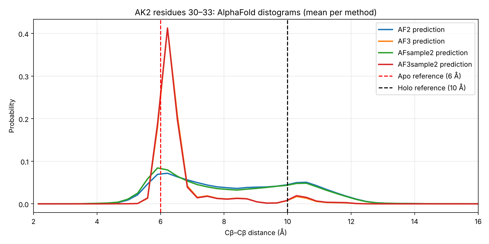
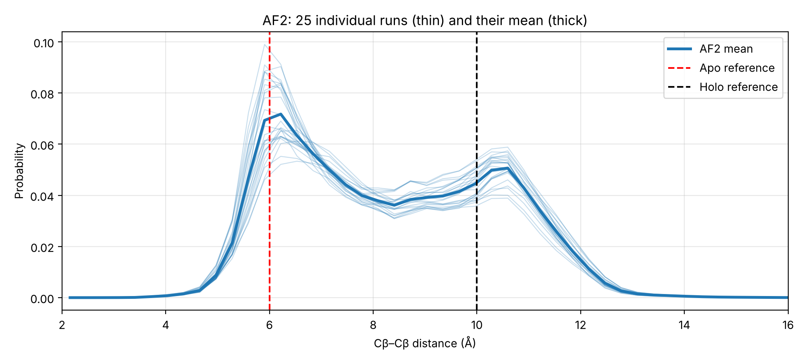

# AlphaFold distograms vs. elastic network models: the AK2 C-terminal tail

[](https://colab.research.google.com/github/VesileHann/ak2_distogram_anm/blob/main/AK2_distogram_ANM.ipynb)

A small, self-directed reproduction and extension of

> Savaş *et al.* (2026). *Exploring the potential of AlphaFold distograms for predicting binding-induced hinge motions.* **FEBS Letters**.

The paper shows that AlphaFold's **distogram** (its per-residue-pair distance probabilities) can contain a second, binding-relevant conformation that the final predicted **structure** discards. This repository:

1. reproduces the distogram analysis for the AK2 marker pair **230–233** from the authors' public data, with automatic peak detection, and
2. asks whether a classical **Anisotropic Network Model (ANM)** can see the same flexibility.

## Background

AK2's C-terminal tail is **coiled** when AK2 is alone (apo, residues 230–233 ≈ **6 Å** apart) and **extended** when it binds AIFM1 (holo, ≈ **10 Å**). AlphaFold is given only AK2, without its partner.

## Key results

**Distograms (mean over all runs per method):**

| Method | Runs | Apo peak | Holo-like peak | P(5–7.5 Å) | P(9–11.5 Å) |
|---|---|---|---|---|---|
| AF2 | 25 | 6.22 Å | 10.59 Å | 0.42 | 0.34 |
| AF3 | 25 | 6.22 Å | 10.28 Å | 0.89 | 0.06 |
| AFsample2 | 500 | 5.91 Å | 10.59 Å | 0.45 | 0.33 |
| AF3sample2 | 500 | 6.22 Å | 10.28 Å | 0.88 | 0.06 |

23 of 25 individual AF2 runs show their own peak in the holo window.





**Structures and ANM:**

- The AlphaFold DB model places residues 230–233 at **6.30 Å**, the apo state. The holo-like state exists only in the distogram.
- The crystal structure (PDB 2C9Y) resolves residues 15–232 only; the tail is missing, so ANM sees no motion there.
- In the full-length AlphaFold model the low-confidence termini (pLDDT ≈ 47–52 at the N-terminus) dominate ANM's slowest modes as loose strings. After trimming to the crystal's range, crystal and AlphaFold models show similar mobile regions, while 230–233 stays flat.

**Takeaway:** ANM captures the enzyme's domain motions but not the tail's switch between two defined shapes, which is visible only in the distogram. This motivates elastic network models informed by distogram information.

## Repository contents

| File | Description |
|---|---|
| `AK2_distogram_ANM.ipynb` | Full analysis, with explanations |
| `figures/` | Figures written by the notebook |
| `requirements.txt` | Python dependencies |
| `LICENSE` | MIT License |

## Running

Click **Open in Colab** above and choose *Runtime → Run all*. Locally:

```bash
pip install -r requirements.txt
jupyter notebook AK2_distogram_ANM.ipynb
```

The notebook downloads its inputs: the distogram CSV from GitHub, PDB 2C9Y from RCSB, and the AlphaFold model (UniProt P54819) from AlphaFold DB. A local ColabFold `rank_001` PDB file is used instead if present.

## Limitations

- One residue pair of one protein, using data released with the paper.
- ANM is a harmonic model around a single structure; it describes small fluctuations, not transitions between distinct conformations, and its fluctuations are relative.
- Residue numbering is assumed to follow UniProt P54819 throughout.

## Data and credits

- Distogram data: [CSB-KaracaLab/af-distogram-flexibility](https://github.com/CSB-KaracaLab/af-distogram-flexibility), from Savaş *et al.* (2026), FEBS Letters.
- Crystal structure: [PDB 2C9Y](https://www.rcsb.org/structure/2C9Y).
- AlphaFold model: [AlphaFold DB, P54819](https://alphafold.ebi.ac.uk/entry/P54819).
- Elastic network models: [ProDy](http://prody.csb.pitt.edu/).

## License

This project is released under the [MIT License](LICENSE).
